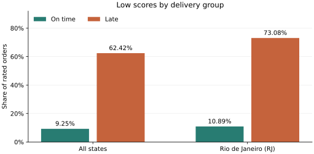

# Olist 电商履约体验诊断与复购基线

用 **MySQL 和 Python** 分析 99,441 笔公开电商订单，寻找配送体验的优先调查对象，并把 SQL 结果与用户评论转化为可验证的产品方案。

## 结果速览

| 分析问题 | 结果 | 对产品的启发 |
| --- | --- | --- |
| 配送延迟和低评分有何关系？ | 主窗口内，已评价的延迟组低评分率为 **62.42%**，准时组为 **9.25%**。里约热内卢州分别为 **73.08%** 与 **10.89%**。 | 优先排查延迟和收货异常体验，并分别查看州、月份和品类。 |
| 先调查哪一类订单？ | 里约热内卢州床品、餐桌及卫浴用品类有 **201 / 1,329** 笔延迟，延迟率 **15.12%**。 | 同时看影响订单数和延迟率，再抽样阅读评论。 |
| 如何建立复购基线？ | 对统一的 **68,617** 名买家留足 90 天观察期。30 / 60 / 90 天累计跨日复购率为 **0.66% / 1.03% / 1.29%**。 | 采用固定买家队列比较窗口，为后续产品验证建立基线。 |



## 从分析到产品方案

1. **建模与对账**。导入 8 张核心表，使用 CTE 分别聚合商品与支付明细，通过窗口函数保留每单最新评价，构建 99,441 行订单视图。商品、运费与支付三项金额差额均为 0。
2. **用评论补充线索**。在目标品类按延迟和评分分层抽取 40 条有正文的评论，试定标签规则，使用 AI 辅助翻译和试标并逐条人工核对。识别到未收货、物流信息、商品质量和缺件等线索。
3. **提出验证方案**。在订单详情中统一展示预计送达日期、最近物流更新时间和收货异常反馈入口。用访谈及原型任务测试观察状态理解准确率、入口查找和反馈完成率。

结果来自观察性数据。配送延迟与低评分的关联仍可能受卖家和品类差异影响。评论样本用于发现线索，候选方案尚待验证。详见[分析报告](docs/analysis.md)与[评论试标口径](docs/review-method.md)。

## 复现方式

环境为 MySQL 8.0 和 Python 3.9 或更高版本。用自己的 MySQL 账号连接本机数据库，密码在运行时隐藏输入。首次导入需要创建表、视图及写入数据的权限。

1. 从 [Olist 在 Kaggle 发布的数据集](https://www.kaggle.com/datasets/olistbr/brazilian-ecommerce) 下载 ZIP，放到 `data/archive.zip`，或用 `--archive` 指定本地路径。仓库提供 SQL、代码和汇总结果。
2. 在仓库根目录运行：

   ```bash
   python -m pip install -r requirements.txt
   python scripts/run_analysis.py init --user root
   python scripts/run_analysis.py run --user root --stage quality
   python scripts/run_analysis.py run --user root
   ```

3. 首次入库后只需执行 `run`。也可运行 [Jupyter 笔记本](notebooks/olist_analysis.ipynb)，通过 Pandas 查看每个阶段的汇总结果。

| 路径 | 用途 |
| --- | --- |
| [数据字典](docs/data-dictionary.md) | 订单、明细、买家及评价关联，指标口径和数据限制 |
| [01–03](sql) | 建表、订单视图、入库行数和金额质量检查 |
| [04 基础分析](sql/04_first_analysis.sql) | 订单状态、成交额、客单价、评分和全窗口复购买家占比 |
| [05 履约诊断](sql/05_fulfillment.sql) | 全样本延迟率、州级、月度与品类分析 |
| [06 复购分析](sql/06_repeat.sql) | 同日购买合并、首购分组及统一 30 / 60 / 90 天窗口 |
| [07 评论覆盖](sql/07_review_coverage.sql) | 文本覆盖和分层抽样条数 |

数据集授权信息见 [Kaggle 数据页](https://www.kaggle.com/olistbr/brazilian-ecommerce)。地理定位表未纳入本轮分析。
